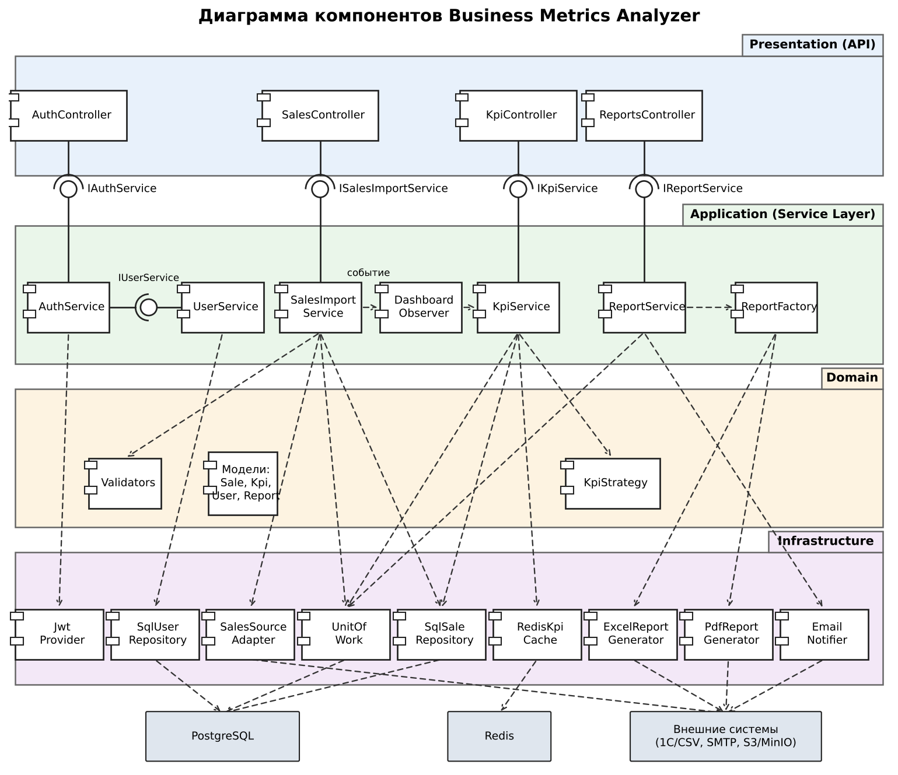
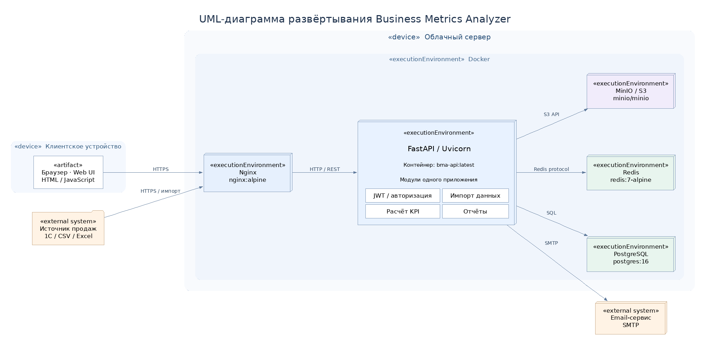

# Архитектура Business Metrics Analyzer

**Архитектурная документация проекта**

Business Metrics Analyzer – веб-приложение для анализа продаж, расчёта ключевых показателей эффективности (KPI) и формирования аналитических отчётов.

Архитектура системы основана на слоистом монолите с элементами Clean Architecture. В качестве основных технологий используются Python, FastAPI, PostgreSQL, Redis, MinIO и Docker.

## Содержание

1. [Обзор системы](#1-обзор-системы)
2. [Архитектурные драйверы](#2-архитектурные-драйверы)
3. [Выбранный архитектурный стиль](#3-выбранный-архитектурный-стиль)
4. [Архитектурные диаграммы](#4-архитектурные-диаграммы)
5. [Слои и компоненты](#5-слои-и-компоненты)
6. [Используемые паттерны](#6-используемые-паттерны)
7. [Технологический стек](#7-технологический-стек)
8. [Ограничения и компромиссы](#8-ограничения-и-компромиссы)
9. [План развития архитектуры](#9-план-развития-архитектуры)
10. [Ссылки на ADR](#10-ссылки-на-adr)

---

## 1. Обзор системы

**Business Metrics Analyzer** – веб-приложение для расчёта и визуализации ключевых показателей эффективности (KPI) торговой компании. Система предназначена для загрузки и обработки данных о продажах, расчёта выручки, среднего чека, конверсии и рентабельности, просмотра дашбордов, формирования и экспорта аналитических отчётов.

Основными пользователями системы являются:

- **Коммерческий директор** – просмотр KPI и аналитических отчётов для принятия управленческих решений.
- **Менеджер по продажам** – работа с данными о продажах.
- **Аналитик** – анализ показателей, формирование и экспорт отчётов.
- **Администратор** – управление пользователями, ролями и настройками системы.

Внешние взаимодействия предусматривают получение данных из 1С, CSV, Excel или API, а также отправку электронных уведомлений через SMTP.

В границы приложения входят веб-интерфейс, REST API, модули аутентификации, импорта, расчёта KPI и формирования отчётов, механизмы хранения данных и файлов отчётов.

Основные требования к системе включают время отклика дашборда не более 3 секунд, обработку до 1 млн записей о продажах, облачное развёртывание с использованием Docker, JWT-аутентификацию и разграничение прав доступа по ролям.

---

## 2. Архитектурные драйверы

При проектировании Business Metrics Analyzer выделены архитектурные драйверы, определяющие требования к производительности, безопасности, обработке данных и организации разработки.

Основные архитектурные драйверы представлены в таблице 1.

**Таблица 1 – Архитектурные драйверы Business Metrics Analyzer**

| ID | Драйвер | Тип | Приоритет | Влияние на архитектуру |
|---|---|---|---|---|
| AD-01 | Время отклика дашборда ≤ 3 с | Нефункциональный (NFR) | Высокий | Кэширование в Redis, предварительный расчёт KPI |
| AD-02 | Разграничение ролей пользователей | Нефункциональный (NFR) | Высокий | Аутентификация по JWT и авторизация с учётом ролей |
| AD-03 | Импорт до 1 млн записей о продажах | Нефункциональный (NFR) | Высокий | Пакетный импорт и асинхронная обработка |
| AD-04 | Быстрый выпуск MVP небольшой командой | Бизнес | Высокий | Единое развёртываемое приложение со слоистой структурой |

Как показано в таблице 1, наибольшее влияние на архитектуру оказывают требования к скорости обработки запросов, безопасности пользовательских данных, обработке больших объёмов информации и срокам разработки MVP.

Приоритеты архитектурных драйверов определены командой в рамках проектирования.

---

## 3. Выбранный архитектурный стиль

Для Business Metrics Analyzer выбран **слоистый монолит с элементами Clean Architecture**.

Данный архитектурный стиль предусматривает развёртывание приложения как единой программной системы с логическим разделением кода на четыре слоя:

- **Presentation** – веб-интерфейс, контроллеры REST API, обработка пользовательских запросов и формирование ответов.
- **Application** – сценарии аутентификации, импорта продаж, расчёта KPI и формирования отчётов.
- **Domain** – модели предметной области, бизнес-правила, формулы расчёта KPI и валидаторы.
- **Infrastructure** – PostgreSQL, репозитории, Redis, файловое хранилище S3/MinIO и внешние интеграции.

**Обоснование выбора.** Использование слоистого монолита позволяет небольшой команде быстрее разработать, протестировать и развернуть MVP. Разделение системы на логические слои уменьшает связанность бизнес-логики с инфраструктурой и упрощает сопровождение приложения.

Для обеспечения требуемого быстродействия предусматривается кэширование результатов расчёта KPI. Для обработки больших объёмов информации применяются механизмы пакетного и асинхронного импорта.

**Рассмотренные альтернативы:**

- **Микросервисная архитектура** – обеспечивает независимое масштабирование отдельных сервисов, однако усложняет инфраструктуру, взаимодействие компонентов и первоначальную разработку.
- **Монолит без разделения на слои** – проще при первоначальной реализации, но затрудняет тестирование, сопровождение и дальнейшее расширение системы.
- **Serverless-архитектура** – предоставляет гибкие механизмы выполнения отдельных функций, однако может усложнить длительную пакетную обработку данных.

**Основные компромиссы.** Единое развёртываемое приложение ограничивает независимое масштабирование отдельных функциональных модулей. Вместе с тем выбранный подход позволяет снизить сложность первоначальной разработки и эксплуатации.

При дальнейшем увеличении нагрузки возможно выделение отдельных компонентов в самостоятельные сервисы.

Подробное обоснование выбранного архитектурного стиля представлено в документе [ADR-001 – Выбор архитектурного стиля](./adr/ADR-001.md).

---

## 4. Архитектурные диаграммы

Для визуального представления архитектуры Business Metrics Analyzer разработаны диаграммы C4 и UML, отражающие взаимодействие системы с внешним окружением, внутреннюю структуру приложения и особенности физического развёртывания.

### 4.1. Диаграмма контекста C4 (уровень 1)

Диаграмма контекста определяет границы Business Metrics Analyzer и взаимодействие с основными пользователями: коммерческим директором, менеджером по продажам, аналитиком и администратором.

Также отображаются внешние системы – источники данных о продажах (1С, CSV, Excel) и сервис электронных уведомлений SMTP.

Взаимодействие приложения с пользователями и внешними системами представлено на рисунке 1.

*Рисунок 1 – Диаграмма контекста C4 Business Metrics Analyzer*

Как показано на рисунке 1, Business Metrics Analyzer обеспечивает централизованное взаимодействие пользователей с аналитическими функциями приложения и внешними источниками информации.

Исходный код диаграммы: [context.puml](./context.puml).

### 4.2. Диаграмма контейнеров C4 (уровень 2)

Диаграмма контейнеров отображает основные части Business Metrics Analyzer, используемые технологии и связи между ними.

В архитектуре предусмотрены Web UI, REST API на FastAPI, модули аутентификации, импорта данных, расчёта KPI и формирования отчётов, а также PostgreSQL, Redis и файловое хранилище MinIO/S3.

Основные части приложения и их взаимодействие представлены на рисунке 2.

*Рисунок 2 – Диаграмма контейнеров C4 Business Metrics Analyzer*

Как показано на рисунке 2, функциональные модули приложения разделены по ответственности. При этом модули аутентификации, импорта, расчёта KPI и формирования отчётов входят в состав единого приложения, что соответствует выбранной монолитной архитектуре.

Исходный код диаграммы: [containers.puml](./containers.puml).

### 4.3. UML-диаграмма компонентов

UML-диаграмма компонентов отражает внутреннюю структуру Business Metrics Analyzer, программные модули, их интерфейсы и зависимости.

Компоненты приложения распределены по четырём логическим слоям: Presentation, Application, Domain и Infrastructure. Такое разделение позволяет отделить обработку пользовательских запросов, бизнес-логику, предметную область и инфраструктурные механизмы.

Структура программных компонентов представлена на рисунке 3.

*Рисунок 3 – UML-диаграмма компонентов Business Metrics Analyzer*

Как показано на рисунке 3, взаимодействие компонентов организовано через соответствующие интерфейсы и зависимости, что упрощает тестирование, сопровождение и дальнейшее расширение системы.

Подробное описание компонентов и их интерфейсов приведено в разделе 5.

Исходный код диаграммы: [components.puml](./components.puml).

### 4.4. UML-диаграмма развёртывания

UML-диаграмма развёртывания отображает физическое размещение компонентов Business Metrics Analyzer в облачной инфраструктуре с использованием Docker.

Пользователь взаимодействует с приложением через веб-браузер. Входящие запросы обрабатываются веб-сервером Nginx и передаются приложению FastAPI/Uvicorn, в котором реализованы модули аутентификации, импорта данных, расчёта KPI и формирования отчётов.

Для хранения информации используется PostgreSQL, для кэширования рассчитанных показателей – Redis, а для хранения сформированных отчётов – MinIO/S3. Также предусмотрено взаимодействие с внешними источниками данных и сервисом SMTP.

Физическая структура развёртывания Business Metrics Analyzer представлена на рисунке 4.

*Рисунок 4 – UML-диаграмма развёртывания Business Metrics Analyzer*

Как показано на рисунке 4, основные бизнес-модули размещаются в едином контейнере приложения, тогда как Nginx, PostgreSQL, Redis и MinIO используются как отдельные инфраструктурные компоненты.

Такое размещение соответствует выбранной архитектуре слоистого монолита и позволяет разделить функции обработки запросов, хранения данных и кэширования.

Файл диаграммы: [deployment.png](./deployment.png).

### 4.5. Параметры развёртывания

Для первоначального развёртывания Business Metrics Analyzer определены основные инфраструктурные компоненты, используемое программное обеспечение и необходимые вычислительные ресурсы.

Планируемые параметры развёртывания представлены в таблице 2.

**Таблица 2 – Параметры развёртывания Business Metrics Analyzer**

| Узел | Образ / ПО | Ресурсы | Назначение |
|---|---|---|---|
| Nginx | `nginx:alpine` | 0.5 CPU, 256 MB | Обратное проксирование, TLS |
| App | `bma-api:latest` | 1 CPU, 1 GB | REST API и бизнес-логика |
| PostgreSQL | `postgres:16` | 2 CPU, 2 GB | Хранение данных |
| Redis | `redis:7-alpine` | 0.5 CPU, 512 MB | Кэширование KPI |
| MinIO | `minio/minio` | 0.5 CPU, 512 MB | Хранение отчётов |

Как показано в таблице 2, предусмотренная инфраструктура обеспечивает обработку входящих запросов, выполнение бизнес-логики, хранение данных, кэширование результатов расчёта KPI и сохранение сформированных отчётов.

Указанные ресурсы являются проектными значениями и могут быть скорректированы по результатам нагрузочного тестирования.

---

## 5. Слои и компоненты

Система Business Metrics Analyzer построена как слоистый монолит с элементами Clean Architecture. Архитектура предусматривает разделение программных компонентов по функциональному назначению и организацию взаимодействия через соответствующие интерфейсы.

UML-диаграмма компонентов представлена в разделе 4, а её исходный код доступен в файле [components.puml](./components.puml).

### 5.1. Состав и ответственность слоёв

Компоненты приложения распределены по четырём логическим слоям: Presentation, Application, Domain и Infrastructure.

Основные компоненты и их ответственность представлены в таблице 3.

**Таблица 3 – Слои и компоненты Business Metrics Analyzer**

| Слой | Компоненты | Ответственность |
|---|---|---|
| Presentation | `auth_controller`, `sales_controller`, `kpi_controller`, `reports_controller` | Обработка HTTP-запросов, проверка токена и роли, DTO |
| Application | `AuthService`, `UserService`, `SalesImportService`, `KpiService`, `ReportService`, `ReportFactory`, `DashboardObserver` | Аутентификация, управление пользователями, импорт, расчёт KPI, отчёты и обновление дашборда |
| Domain | `Sale`, `Kpi`, `User`, `Report`, `KpiStrategy`, `Validators` | Бизнес-правила и формулы расчёта KPI |
| Infrastructure | `SqlSaleRepository`, `SqlUserRepository`, `UnitOfWork`, `JwtProvider`, `SalesSourceAdapter`, `RedisKpiCache`, `ExcelReportGenerator`, `PdfReportGenerator`, `EmailNotifier` | Доступ к PostgreSQL, JWT, 1С/CSV, Redis, генерация Excel и PDF, email-уведомления |

Как показано в таблице 3, компоненты Business Metrics Analyzer разделены по функциональному назначению, что позволяет снизить связанность программных модулей и повысить удобство их сопровождения.

Для организации взаимодействия между компонентами используются паттерны Repository, Unit of Work, Strategy, Factory, Observer, Adapter и Service Layer.

### 5.2. Интерфейсы компонентов

Взаимодействие программных компонентов осуществляется через предоставляемые и требуемые интерфейсы, определяющие доступные операции и порядок обмена данными.

Основные интерфейсы компонентов Business Metrics Analyzer представлены в таблице 4.

**Таблица 4 – Интерфейсы компонентов и основные методы**

| Компонент | Интерфейс | Методы |
|---|---|---|
| AuthService | IAuthService | `login(email, password)`, `verify_token(token)`, `check_role(user, role)` |
| UserService | IUserService | `create_user(dto)`, `get_by_email(email)`, `change_role(user_id, role)` |
| SalesImportService | ISalesImportService | `import_csv(file)`, `validate(records)` |
| KpiService | IKpiService | `calculate_period(period)`, `get_dashboard(period)` |
| ReportService | IReportService | `generate(report_type, period)`, `export_excel(report_id)` |
| SqlSaleRepository | ISaleRepository | `add(record)`, `get_by_period(period)` |
| SqlUserRepository | IUserRepository | `add(user)`, `get_by_email(email)` |
| UnitOfWork | IUnitOfWork | `__enter__()`, `__exit__()`, `sales`, `users` |
| JwtProvider | ITokenProvider | `create_token(user)`, `decode(token)` |
| ExcelReportGenerator, PdfReportGenerator | IReportGenerator | `build(report)` |
| EmailNotifier | INotifier | `send(to, subject, attachment)` |
| DashboardObserver | IObserver | `on_data_changed(period)` |
| ReportFactory | IReportFactory | `create(report_type)` |
| SalesSourceAdapter | ISalesSource | `fetch(period)` |
| RedisKpiCache | IKpiCache | `get(key)`, `set(key, value, ttl)`, `invalidate(period)` |

Как показано в таблице 4, интерфейсы определяют основные операции компонентов, необходимые для выполнения бизнес-функций приложения.

Использование интерфейсов упрощает замену инфраструктурных реализаций, тестирование отдельных модулей и дальнейшее развитие системы.

---

## 6. Используемые паттерны

Для проектирования Business Metrics Analyzer выбраны восемь паттернов: Repository, Unit of Work, Service Layer, Factory, Strategy, DTO, Adapter и Observer.

Паттерны применяются для разделения ответственности между компонентами системы, повышения тестируемости, упрощения сопровождения и расширения приложения.

Назначение выбранных паттернов представлено в таблице 5.

**Таблица 5 – Используемые паттерны проектирования**

| Паттерн | Назначение в системе |
|---|---|
| Repository | Организация доступа к данным о продажах в PostgreSQL |
| Unit of Work | Управление транзакциями при импорте данных |
| Service Layer | Отделение бизнес-логики расчёта KPI от API-контроллеров |
| Factory | Создание отчётов в различных форматах, включая PDF и Excel |
| Strategy | Реализация различных алгоритмов расчёта KPI |
| DTO | Передача структурированных данных между API и клиентским интерфейсом |
| Adapter | Интеграция с внешними информационными системами |
| Observer | Реакция на изменения данных и обновление дашборда |

Как показано в таблице 5, выбранные паттерны охватывают работу с данными, выполнение бизнес-операций, формирование отчётов и взаимодействие с внешними системами.

Для паттернов Repository, Unit of Work и Strategy подготовлены примеры реализации на Python.

Подробная таблица с обоснованием выбора, альтернативами и примерами кода представлена в документе [patterns.md](./patterns.md).

---

## 7. Технологический стек

Для реализации Business Metrics Analyzer выбран технологический стек, обеспечивающий разработку веб-приложения, выполнение аналитических расчётов, хранение данных, формирование отчётов и развёртывание в контейнерной инфраструктуре.

Используемые технологии и их назначение представлены в таблице 6.

**Таблица 6 – Технологический стек Business Metrics Analyzer**

| Технология | Назначение |
|---|---|
| Python 3.10+ | Основной язык программирования |
| FastAPI | Разработка REST API приложения |
| Uvicorn | Запуск ASGI-приложения FastAPI |
| HTML / JavaScript | Пользовательский веб-интерфейс |
| SQLAlchemy | Взаимодействие с базой данных |
| PostgreSQL 16 | Хранение данных о продажах и пользователях |
| Redis 7 | Кэширование результатов расчёта KPI |
| pandas | Импорт и обработка данных о продажах |
| openpyxl | Формирование и экспорт Excel-отчётов |
| Nginx | Обработка входящих запросов и обратное проксирование |
| Docker | Контейнеризация и развёртывание приложения |
| MinIO / S3 | Хранение сформированных отчётов |
| JWT | Аутентификация и авторизация пользователей |
| SMTP | Отправка электронных уведомлений |

Как показано в таблице 6, выбранные технологии обеспечивают реализацию основных функций Business Metrics Analyzer и соответствуют требованиям к обработке данных, безопасности и развёртыванию приложения.

Применение распространённых программных инструментов также упрощает сопровождение системы и предусматривает возможность её дальнейшего расширения.

---

## 8. Ограничения и компромиссы

Архитектура Business Metrics Analyzer проектируется с учётом ограничений MVP, небольшого размера команды и требований к производительности.

При выборе технических решений учитываются функциональные возможности используемых технологий, а также затраты на разработку, сопровождение и масштабирование приложения.

Основные архитектурные ограничения и компромиссы представлены в таблице 7.

**Таблица 7 – Архитектурные ограничения и компромиссы**

| Решение / ограничение | Преимущество | Компромисс |
|---|---|---|
| Слоистый монолит | Упрощает разработку, тестирование и развёртывание MVP | Независимое масштабирование отдельных функций затруднено |
| PostgreSQL | Обеспечивает целостность и согласованность данных | При больших объёмах продаж потребуется оптимизация запросов и индексов |
| Redis для KPI | Ускоряет повторные запросы и снижает нагрузку на БД | Требует дополнительной инфраструктуры и контроля актуальности кэша |
| Импорт до 1 млн записей | Позволяет анализировать большие наборы данных | Может потребоваться пакетная и асинхронная обработка |
| Формирование PDF и Excel | Поддерживает различные форматы отчётности | Создание крупных отчётов может занимать значительное время |

Как показано в таблице 7, выбранные архитектурные решения предполагают определённые ограничения, однако позволяют сохранить относительно простую структуру системы на этапе MVP.

Для устранения выявленных ограничений в дальнейшем предусматривается оптимизация запросов, совершенствование обработки данных и возможное выделение отдельных компонентов в самостоятельные сервисы.

---

## 9. План развития архитектуры

Развитие Business Metrics Analyzer планируется осуществлять постепенно, по мере увеличения количества пользователей, объёма обрабатываемой информации и расширения функциональных требований.

Основные направления дальнейшего развития архитектуры представлены в таблице 8.

**Таблица 8 – План развития архитектуры Business Metrics Analyzer**

| Направление | Планируемое развитие |
|---|---|
| Оптимизация расчёта KPI | Улучшение SQL-запросов, добавление индексов и настройка кэширования результатов в Redis |
| Развитие импорта данных | Реализация пакетной и асинхронной обработки больших файлов с данными о продажах |
| Расширение аналитических возможностей | Добавление новых KPI и алгоритмов расчёта с использованием паттерна Strategy |
| Совершенствование отчётности | Поддержка новых форматов отчётов и перенос длительных операций в фоновые задачи |
| Развитие интеграций | Подключение дополнительных учётных систем и сервисов уведомлений через Adapter |
| Масштабирование архитектуры | При необходимости выделение отдельных компонентов, например сервиса отчётности, в самостоятельные сервисы |
| Повышение наблюдаемости | Добавление мониторинга производительности, журналирования ошибок и контроля времени ответа API |

Как показано в таблице 8, развитие архитектуры предусматривает последовательное совершенствование производительности, функциональных возможностей и механизмов сопровождения приложения.

Переход к более сложной архитектуре должен осуществляться только при наличии подтверждённой необходимости, чтобы избежать избыточного усложнения системы на этапе MVP.

---

## 10. Ссылки на ADR

В рамках проектирования Business Metrics Analyzer основные архитектурные решения фиксируются в документах ADR (Architecture Decision Record).

Каждый документ содержит контекст принятия решения, выбранный вариант, рассмотренные альтернативы и последствия для дальнейшей разработки и сопровождения приложения.

Перечень архитектурных решений представлен в таблице 9.

**Таблица 9 – Архитектурные решения Business Metrics Analyzer**

| ADR | Решение | Статус |
|---|---|---|
| [ADR-001](./adr/ADR-001.md) | Выбор архитектурного стиля: слоистый монолит с элементами Clean Architecture | Принято |
| [ADR-002](./adr/ADR-002.md) | Выбор СУБД PostgreSQL | Принято |
| [ADR-003](./adr/ADR-003.md) | Выбор способа аутентификации JWT | Принято |
| [ADR-004](./adr/ADR-004.md) | Кэширование KPI через Redis | Принято |

Как показано в таблице 9, основные архитектурные решения охватывают выбор структуры приложения, системы управления базами данных, механизмов аутентификации и средств повышения производительности.

Документирование решений в формате ADR обеспечивает прозрачность выбора технических подходов и облегчает их последующий пересмотр при развитии Business Metrics Analyzer.
