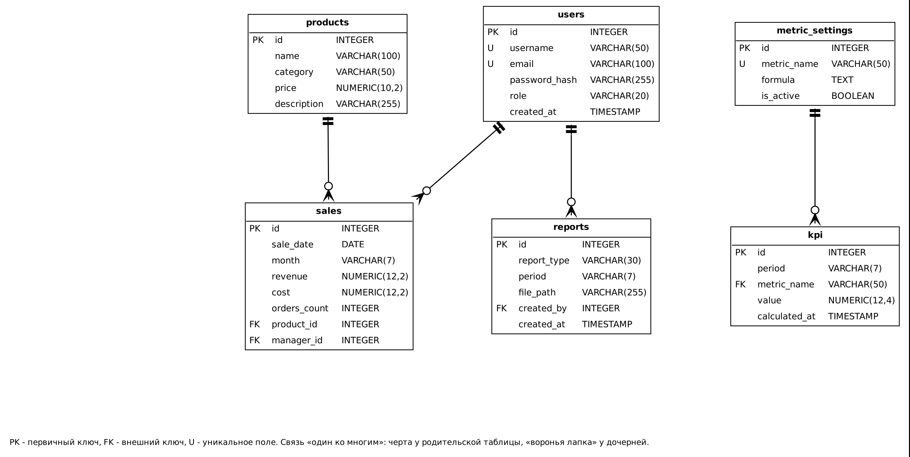

# Схема базы данных Business Metrics Analyzer

СУБД: PostgreSQL 16 (ADR-002). Для локальной разработки по умолчанию используется SQLite (`DATABASE_URL` в `.env`). Доступ к данным — SQLAlchemy 2.0, миграции — Alembic.

## 1. ER-диаграмма

Ссылка на файл: ./er_diagram.png

Исходник диаграммы: [er_diagram.dot](er_diagram.dot).

## 2. Таблицы

### users — пользователи

| Столбец | Тип | Ограничения | Описание |
|---|---|---|---|
| id | integer | PK | Идентификатор |
| username | varchar(50) | NOT NULL, UNIQUE | Логин |
| email | varchar(100) | NOT NULL, UNIQUE | Электронная почта |
| password_hash | varchar(255) | NOT NULL | Хеш пароля |
| role | varchar(20) | NOT NULL | Роль (director, manager, analyst, admin) |
| created_at | timestamp | NOT NULL, default now | Дата создания |

### products — товары

| Столбец | Тип | Ограничения | Описание |
|---|---|---|---|
| id | integer | PK | Идентификатор |
| name | varchar(100) | NOT NULL | Название |
| category | varchar(50) | NOT NULL | Категория |
| price | numeric(10,2) | NOT NULL | Цена |
| description | varchar(255) | NULL | Описание товара (добавлено миграцией bdc5b43c0955) |

### sales — продажи

| Столбец | Тип | Ограничения | Описание |
|---|---|---|---|
| id | integer | PK | Идентификатор |
| sale_date | date | NOT NULL | Дата продажи |
| month | varchar(7) | NOT NULL, индекс | Месяц в формате YYYY-MM |
| revenue | numeric(12,2) | NOT NULL | Выручка |
| cost | numeric(12,2) | NOT NULL | Себестоимость |
| orders_count | integer | NOT NULL, default 1 | Число заказов |
| product_id | integer | NOT NULL, FK → products.id | Товар |
| manager_id | integer | NOT NULL, FK → users.id | Менеджер |

### kpi — рассчитанные показатели

| Столбец | Тип | Ограничения | Описание |
|---|---|---|---|
| id | integer | PK | Идентификатор |
| period | varchar(7) | NOT NULL | Период YYYY-MM |
| metric_name | varchar(50) | NOT NULL, FK → metric_settings.metric_name | Название метрики |
| value | numeric(12,4) | NOT NULL | Значение |
| calculated_at | timestamp | NOT NULL, default now | Время расчёта |

### reports — отчёты

| Столбец | Тип | Ограничения | Описание |
|---|---|---|---|
| id | integer | PK | Идентификатор |
| report_type | varchar(30) | NOT NULL | Тип отчёта |
| period | varchar(7) | NOT NULL | Период YYYY-MM |
| file_path | varchar(255) | NOT NULL | Путь к файлу отчёта |
| created_by | integer | NOT NULL, FK → users.id | Автор отчёта |
| created_at | timestamp | NOT NULL, default now | Дата создания |

### metric_settings — настройки метрик

| Столбец | Тип | Ограничения | Описание |
|---|---|---|---|
| id | integer | PK | Идентификатор |
| metric_name | varchar(50) | NOT NULL, UNIQUE | Название метрики |
| formula | text | NOT NULL | Формула расчёта |
| is_active | boolean | NOT NULL, default true | Используется ли метрика |

## 3. Связи

| Родительская таблица | Дочерняя таблица | Тип | Ключ |
|---|---|---|---|
| users | sales | 1:N | sales.manager_id → users.id |
| products | sales | 1:N | sales.product_id → products.id |
| users | reports | 1:N | reports.created_by → users.id |
| metric_settings | kpi | 1:N | kpi.metric_name → metric_settings.metric_name |

Связей N:M и 1:1 в модели нет. Один менеджер проводит много продаж, один товар встречается во многих продажах, один пользователь создаёт много отчётов, одна метрика имеет много значений по периодам.

## 4. Индексы

| Таблица | Индекс | Назначение |
|---|---|---|
| sales | ix_sales_month | Ускорение запросов и агрегации KPI по месяцу (NFR-01, дашборд до 3 с) |

## 5. Миграции

| Ревизия | Описание | Дата |
|---|---|---|
| da69ad5cc6f2 | Создание начальных таблиц (create initial tables) | 2026-11-19 |
| bdc5b43c0955 | Добавление поля products.description (add product description) | 2026-11-19 |

Команды: `alembic upgrade head` применяет все миграции, `alembic downgrade -1` откатывает последнюю, `alembic current` показывает текущую ревизию.

## 6. Нормализация

**1НФ.** Все значения атомарны: нет списков и составных значений в одном столбце, в каждой таблице есть первичный ключ, повторяющихся групп столбцов нет.

**2НФ.** Во всех таблицах первичный ключ простой (один столбец id), поэтому частичных зависимостей от части ключа быть не может. Каждый неключевой атрибут зависит от всего ключа.

**3НФ.** Транзитивных зависимостей нет: данные пользователя хранятся только в users (в sales и reports лежит лишь ссылка), данные товара — только в products, формулы метрик — только в metric_settings. Название и цена товара в sales не дублируются.

**Осознанное исключение: sales.month.** Поле month вычисляется из sale_date, то есть формально это транзитивная зависимость (id → sale_date → month). Мы оставляем его намеренно: KPI считаются по месяцам, а индекс по готовому месяцу ускоряет агрегаты и помогает уложиться в требование NFR-01 (дашборд до 3 секунд). Согласованность обеспечивает приложение: month заполняется из sale_date при создании записи. Если требование к скорости снимется, поле можно удалить без потери данных.

**Категория товара.** Поле products.category хранится как атрибут товара. Если категорий станет много и понадобятся их свойства, её можно вынести в отдельную таблицу.

## 7. Допущения

- Конверсия не хранится отдельно: данных о посетителях нет, считаем по orders_count.
- Формат периода во всех таблицах — YYYY-MM.
- Роли хранятся кодами: director, manager, analyst, admin; допустимые значения проверяет приложение.
